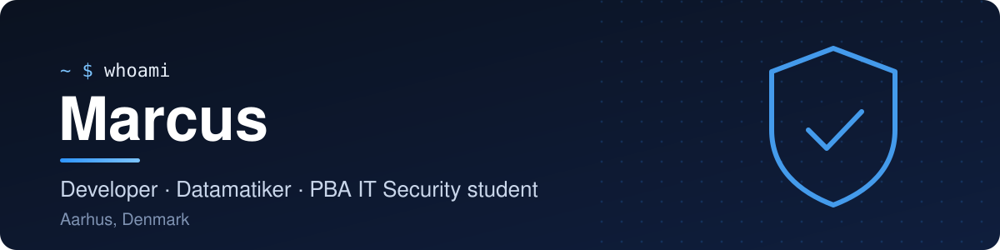

<p>
  <a href="https://www.linkedin.com/in/marcus-husted-70683a443"></a>
  <a href="https://tryhackme.com/p/marcusaj.husted"></a>
  <a href="https://profile.hackthebox.com/profile/01a07f2f-2a89-704f-b80d-5c358377b8f7"></a>
</p>

I'm a developer with an AP Degree in Computer Science (Datamatiker), now studying for a
Professional Bachelor in IT Security. I like building small, focused tools and care about
what surrounds the code: **privacy by default**, tests, CI and repeatable releases.

## Featured project

<h3>
  <a href="https://github.com/MHusted01/shortcutlens"></a>
  <a href="https://github.com/MHusted01/shortcutlens">ShortcutLens</a>
</h3>

Hold Command to see every keyboard shortcut of the app you're using. A native macOS app in
Swift (AppKit + SwiftUI) that reads the menu bar through the macOS Accessibility API.

<a href="https://github.com/MHusted01/shortcutlens">
  <picture>
    <source media="(prefers-color-scheme: dark)" srcset="https://github.com/MHusted01/shortcutlens/raw/main/docs/images/overlay-dark.png">
    
  </picture>
</a>

- **Privacy by design**: no network code at all, enforced by a CI check on every pull request
- **Tested**: Swift 6 with strict concurrency, 560+ tests and an 80% coverage gate
- **Shipped**: tag-driven releases with checksums, distributed through a Homebrew tap

```sh
brew install --cask mhusted01/tap/shortcutlens
```

## More projects

| Project | What it is | Stack |
|---|---|---|
| [**Darting**](https://github.com/MHusted01/Darting) | Dart scoring app with stats, friends and clubs | Expo, TypeScript, Supabase |
| [**ReceptSystem**](https://github.com/MHusted01/ReceptSystem) | Prescription system with API, web and mobile clients | C#, .NET, Entity Framework |
| [**SpaceX Launches**](https://github.com/MHusted01/SpaceXAppExam) | iOS app for SpaceX launches, crews and launchpads | Swift, SwiftUI, MapKit |

## Tools

**Languages**<br>


**Frameworks and platforms**<br>

